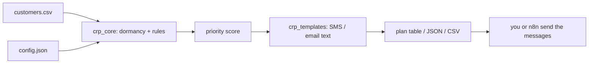

# Customer Reactivation Planner: open-source Python tool to win back dormant customers

   

**Customer Reactivation Planner is a free, self-hosted Python tool that turns a customer CSV into a daily, prioritized win-back plan (SMS or email text included) for service businesses such as HVAC, roofing, salons, clinics and cleaners.**

## Why / problem it solves

Most service businesses have hundreds of past customers who simply never rebooked. Win-back SaaS tools cost monthly fees and need a CRM integration; spreadsheets get ignored. This tool answers one question every morning: *"Who should I message today, with what, and who should I leave alone?"*

## 2-minute Quickstart

```bash
git clone https://github.com/Waqas-Ai-Engineer/customer-reactivation-planner
cd customer-reactivation-planner
python crp.py demo          # offline demo, sample data, no install needed
python -m unittest          # run the tests
```

Use your own data:

```bash
python crp.py plan --csv my_customers.csv --config example_config.json --messages --export plan.csv
```

## Demo output (real output of `python crp.py demo`, sample fictional data)

```text
Reactivation plan for 2026-10-17

 #  Customer          Ch    Tier       Days  Score      LTV  VIP
--------------------------------------------------------------
 1  Dana Whitfield    sms   win_back    320   67.5     1850  *
 2  Grace Okafor      sms   check_in    168   65.0     1120  *
 3  Alicia Gomez      sms   last_call   563   62.5     2400  *
 4  Priya Nair        email last_call   392   59.0      980  
 5  Marcus Lee        sms   win_back    221   26.0      420  

Contacts today: 5   Deferred (daily cap): 0   Skipped: 4
Historical lifetime value of these customers: $6,770 (past spend, not a forecast)

Skipped:
```

## Features

- Dormancy tiers (check-in 90d, win-back 180d, last call 365d) fully configurable.
- Priority score (0-100) from lifetime value, visit count and how overdue the customer is versus their usual service interval.
- Safety rules: skips opted-out customers, enforces a contact cooldown, caps messages per day, skips rows with no phone/email.
- SMS first, email fallback; ready-to-send text with STOP opt-out line. Edit `crp_templates.py`.
- CSV and JSON export for mail-merge, n8n, Zapier or Make.
- Zero dependencies, deterministic, fully tested.

## How it works



The tool plans; it never sends. You stay in control of delivery and consent.

## Input format

See `example_customers.csv`. Columns: name (required), phone, email, last_service_date (YYYY-MM-DD), last_service, lifetime_value, visits, opted_out, last_contacted, service_interval_days. Config options are in `example_config.json`.

## Use cases by industry

- **HVAC / plumbing:** seasonal tune-up reminders for customers not seen in 6-12 months.
- **Roofing / landscaping:** re-engage past quotes and one-off jobs.
- **Salons / barbers / spas:** bring back clients who skipped their usual interval.
- **Clinics / dentists:** recall lists for patients overdue for a visit (check local rules first, see COMPLIANCE.md).
- **Freelancers / agencies:** run it for clients as a monthly reactivation report.

## FAQ

**How do I win back old customers automatically?** Export customers from your CRM or booking tool to CSV, run `python crp.py plan --csv file.csv --messages`, and send the generated texts (manually or through n8n/Zapier).

**Is it free?** Yes. MIT licensed, no accounts, no API keys.

**Does it send SMS or emails by itself?** No. It produces the plan and message text; sending stays with you so consent and deliverability are in your hands.

**Is this an alternative to paid win-back / CRM reactivation tools?** It covers the planning step for small businesses at zero cost; it does not replace a full CRM.

**Is it legal to text my past customers?** Rules differ by country and state (TCPA, GDPR, CAN-SPAM, etc.). Read COMPLIANCE.md; this is not legal advice.

**What Python version do I need?** 3.8+, standard library only.

**Can I change the message wording?** Yes, edit `crp_templates.py` or the offer text in the config.

**Can I use it with n8n?** Yes: run `--json` or `--export plan.csv` and read it with an Execute Command / Read Files node.

## Roadmap

- Optional per-industry template packs
- Appointment-booking link per customer
- Weekly summary report
- Ideas welcome via issues

## Contributing

See CONTRIBUTING.md. Bug reports and template contributions are welcome.

## Hire me / Need this built?

I'm Muhammad Waqas, AI Agents & Business Automation. If you want this wired into your CRM, WhatsApp, n8n or booking system, reach me via https://github.com/Waqas-Ai-Engineer.

## License

MIT, see LICENSE.

---

Star this repo if it helped. Follow [@Waqas-Ai-Engineer](https://github.com/Waqas-Ai-Engineer) for daily open-source automation tools.
